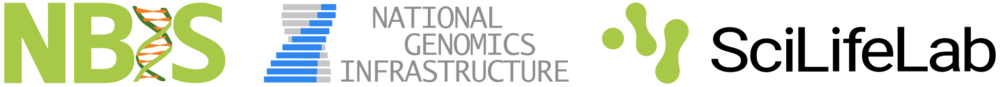

## Syllabus

::: {.syllabus-grid}
::: {.syllabus-card .wide}
####  UNIX/Linux command line {#unix-linux}

- Navigation and directory management: `cd`, `mkdir`, `rm`, `rmdir`
- Common tools: `cp`, `mv`, `tar`, `less`, `more`, `head`, `tail`, `nano`, `grep`, `top`, `man`
- Wildcards
- Ownership and permissions
- Symbolic links
- Piping commands
:::

::: {.syllabus-card}
####  Remote computing cluster {#hpc-cluster}

- Logging on to a high-performance computing (HPC) cluster
- Booking resources
- Job templates, submission and queues
- Software modules
:::

::: {.syllabus-card}
####  NGS data & quality control {#ngs-qc}

- Common bioinformatic and NGS file formats
- Quality control of sequencing data
- Commonly used bioinformatic tools and pipelines
- Working with the Integrative Genomics Viewer (IGV)
:::

::: {.syllabus-card}
####  DNA variant calling {#variant-calling}

- Mapping reads to the reference genome
- Variant detection
- The VCF file format
:::

::: {.syllabus-card}
####  Bulk RNA-seq analysis {#rna-seq}

- RNA-seq experimental design and considerations
- Quality control, mapping and generation of gene expression counts
- Differential gene expression analysis
:::
:::

## Learning outcomes

After this workshop, you should be able to:

::: {.details-grid}
::: {.details-section}

#### Foundations and computing

::: {.detail-list .checks}
-  Describe the basic principles of next-generation sequencing.
-  Use the Linux command line to manage simple file processing operations and organize directory structures.
-  Connect to and work on a remote high-performance computing cluster.
-  Apply programs in Linux for analysis of NGS data.
-  Summarize the applications, strengths and weaknesses of current NGS technologies, and when to use each approach.
-  Explain common NGS file formats.
:::
:::

::: {.details-section}

#### Sequence analysis

::: {.detail-list .checks}
-  Interpret quality control of NGS reads.
-  Explain the steps involved in variant calling using whole-genome sequencing data.
-  Independently perform a basic variant calling workflow on example data.
-  Demonstrate hands-on experience with raw RNA sequencing data, quality control and quantification of gene expression.
-  Explain the steps involved in differential gene expression analysis using RNA-seq data.
:::
:::
:::

## Who can apply?

::: {.details-grid}
::: {.details-section}

#### Eligibility

::: {.detail-list}
- **Audience:** PhD students, postdocs and other researchers affiliated with Swedish academia, healthcare, government institutions or industry
- **Background:** Genetics, cell biology, biomedicine, biochemistry, bioinformatics or a comparable field; no prior bioinformatics experience is needed
- **Equipment:** Bring your own laptop, configured according to the pre-course instructions
- **Research:** To get the most from the workshop, have a project in which you are using or planning to use NGS
:::
:::

::: {.details-section}

#### How selection works

::: {.detail-list}
- **Criteria:** Entry requirements, motivation to attend, and gender and geographical balance are considered when applications exceed capacity
- **Priority:** PhD students are prioritized, followed by postdocs, PIs and other researchers
- **Master's students:** Accepted when seats are available
- **International applicants:** Accepted when seats are available
:::
:::
:::

::: {.fee-note}
NBIS training events do not provide formal university credits. If credits are essential, consult your home department **before applying** to establish whether it can recognize the workshop for credits. Participants with **full attendance and completion of the tasks** receive a certificate of participation stating the topics covered and the duration of the workshop.
:::

## Upcoming workshop

This workshop typically runs twice a year, once in spring (Mar/Apr/May) and once in autumn (Sep/Oct/Nov). Upcoming workshops are announced on [SciLifeLab Training](https://training.scilifelab.se/) and [NBIS Training](https://nbis.se/training) a few months in advance. In case of a planned upcoming workshop, you will see registration information below.

::: {.registration}

## Registration

::: {.details-section}

#### Course fees

::: {.fee-list}
::: {.fee-item .hidden}
[On-site]{.fee-mode} Academia, healthcare, etc.

**SEK 3,000**
:::

::: {.fee-item .hidden}
[On-site]{.fee-mode} Industry

**SEK 15,000**
:::

::: {.fee-item}
[Online]{.fee-mode} All participants

**SEK 1,000**
:::
:::

::: {.fee-note}
An institutional reference is required for invoicing as NBIS cannot invoice individuals. [For on-site courses, the fee includes lunch, coffee, tea and snacks twice a day, and one course dinner. Travel and accommodation are not included; arrange and pay for your own.]{.hidden} Participants are invoiced six weeks before the workshop. No refunds are provided for cancellations.
:::
:::

::: {.details-section}

#### Key dates

::: {.timeline}
::: {.timeline-step}
**03 Nov 2026**  
Applications open
:::

::: {.timeline-step}
**28 Feb 2027**  
Applications close
:::

::: {.timeline-step}
**01-03 Mar 2027**  
Decision
:::

::: {.timeline-step}
**08 Mar 2027**  
Confirmation, invoicing
:::

::: {.timeline-step}
**19-23 Apr 2027**  
Workshop week
:::
:::
:::

::: {.reg-hero}
::: {.reg-hero-text}
[ Applications open]{.reg-status}

::: {.reg-meta}
[ 19-23 April 2027]{.reg-detail}

[ Online]{.reg-detail}
:::
:::

::: {.reg-hero-cta}
[[[ Apply now]{.large .text-whitesmoke}](https://nbis.typeform.com/ngsintro-2704){target="_blank" rel="noopener"}]{.btn .btn-primary}
:::
:::

:::

## Instances

Course materials and practical information for each workshop instance.

::: {style="margin-bottom: 2em;"}

:::

## Contact

::: {.details-grid}
::: {.details-section}
#### Get in touch

Diana Ekman, Martin Dahlö & Estelle Proux-Wéra [[edu.intro-ngs@nbis.se](mailto:edu.intro-ngs@nbis.se)]{.badge .badge-tertiary}
:::

::: {.details-section}
#### Code of conduct

By participating in this workshop, you agree to the [NBIS Code of Conduct](https://nbisweden.github.io/workshop-ngsintro/2704/home_coc.html).
:::
:::

---

{height="26px" fig-alt="NBIS, SciLifeLab and NGI logos"}

<a href="https://nbisweden.github.io/workshop-ngsintro">Introduction to Bioinformatics using NGS data</a>, a workshop created by <a href="https://nbis.se/">National Bioinformatics Infrastructure (NBIS)</a> in partnership with <a href="https://ngisweden.scilifelab.se/">National Genomics Infrastructure (NGI)</a> is licensed under <a href="https://creativecommons.org/licenses/by-nc-sa/4.0/">CC BY-NC-SA 4.0</a>

